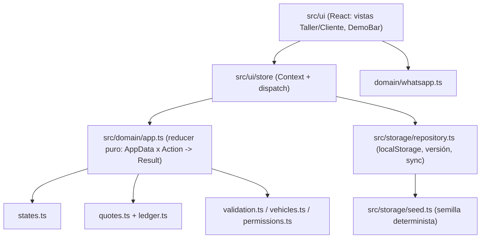
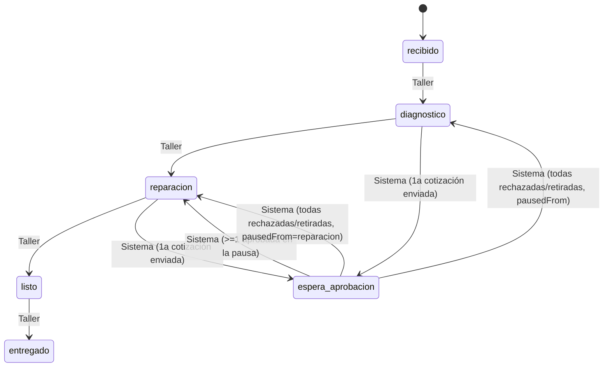

# Plan técnico — Spec 001: Estado del vehículo y cotizaciones adicionales

- **Spec:** `specs/001-estado-y-cotizaciones/spec.md` (Revisión 2, aprobada)
- **Constitución:** `docs/constitution.md`
- **Fecha:** 2026-10-26

## 1. Decisiones de arquitectura

| Tema | Decisión | Motivo |
|---|---|---|
| Stack | React + Vite + TypeScript (strict) | Constitución §6 |
| Tests | Vitest + jsdom + @testing-library/react (+ jest-dom, user-event) | Constitución §5 (TDD) |
| Router | Hash routing propio (`useHashRoute`, ~40 líneas) | RF-37; sin dependencias; enlaces directos en hosting estático |
| Estado | `React Context` + reducer de dominio puro; cada mutación = *leer almacenamiento → aplicar → guardar* | Sin librerías; garantiza RF-17/RNF-09 entre pestañas |
| Persistencia | `localStorage` con `schemaVersion`, validación al cargar y semilla determinista | RF-26, RF-29, RF-36 |
| Estilos | CSS propio mobile-first (variables CSS, un único `styles.css` + módulos por vista si hace falta) | Constitución §6, RF-08 |
| Dinero | Enteros en pesos MXN; formato con `Intl.NumberFormat('es-MX', {style:'currency', currency:'MXN'})` | S-08, RNF-04 |
| Fechas | ISO 8601 en datos; formato `Intl.DateTimeFormat('es-MX')` en UI | RNF-04 |
| Aleatoriedad/tiempo | Inyectados en el dominio (`Deps = { now(): string; id(): string; token(): string }`) | Tests deterministas |



## 2. Estructura de módulos

```
index.html
vite.config.ts            # plugin react + bloque test (jsdom, setupFiles)
tsconfig*.json
vercel.json               # opcional, ver §7
src/
  main.tsx, App.tsx, styles.css
  test/setup.ts           # import '@testing-library/jest-dom/vitest'
  domain/                 # TypeScript puro, sin React ni window
    types.ts              # tipos del modelo (§3)
    states.ts             # flujo lineal, siguiente/anterior, avanzar, corregir
    quotes.ts             # borrador, enviar, decidir, retirar, pausa/reanudación
    ledger.ts             # construcción de entradas (solo-agregar)
    validation.ts         # alta, teléfono, placas, nombre de quien decide
    vehicles.ts           # crear vehículo
    token.ts              # token aleatorio alfanumérico ≥10 (12 por defecto)
    permissions.ts        # qué puede cada rol
    whatsapp.ts           # mensajes y URL wa.me, URL del cliente
    format.ts             # MXN y fecha/hora es-MX
    app.ts                # reducer: applyAction(data, action, deps) -> Result
    *.test.ts
  storage/
    schema.ts             # SCHEMA_VERSION, isAppData(x)
    seed.ts               # createSeed(now): AppData con ids/tokens fijos
    repository.ts         # load/save/reset/subscribe
    *.test.ts
  ui/
    router.ts             # useHashRoute, navigate, parseRoute
    store.tsx             # AppProvider, useApp (data, prefs, dispatch, notice)
    components/           # DemoBar, DemoBanner, ConfirmDialog, StatusBadge,
                          # ProgressLine, StateHistory, LedgerList, ShareButtons, Notice
    taller/               # VehicleList, VehicleDetail, NewVehicleForm,
                          # QuoteDraft, CatalogEditor
    cliente/              # ClientView, DecisionDialog, InvalidLink
    *.test.tsx
```

Regla: `src/domain` no importa nada de `src/storage` ni `src/ui`; `src/storage` solo importa tipos/validación de `src/domain`.

## 3. Modelo de datos

```ts
type VehicleState = 'recibido' | 'diagnostico' | 'espera_aprobacion'
                  | 'reparacion' | 'listo' | 'entregado';
type ManualState = Exclude<VehicleState, 'espera_aprobacion'>;
type Role = 'mecanico' | 'jefe';
type Actor = { kind: 'taller'; role: Role } | { kind: 'cliente' } | { kind: 'sistema' };

interface Vehicle {
  id: string; token: string; isSeed: boolean;
  clientName: string; phone: string;        // '52' + 10 dígitos
  vehicleDesc: string; plates: string;      // placas normalizadas (mayúsculas, sin espacios/guiones)
  reason?: string;
  state: VehicleState;
  pausedFrom: ManualState | null;           // solo se fija al entrar en pausa (S-10)
  pauseId: string | null;                   // agrupa cotizaciones de la pausa actual (RF-11)
  createdAt: string; updatedAt: string;
}

interface CatalogItem { id: string; label: string; suggestedPrice: number; }

interface QuoteDraft { catalogItemId: string; amount: number; note: string; }   // solo estado de UI

interface Quote {                            // inmutable una vez creada, salvo `status`
  id: string; vehicleId: string; pauseId: string;
  catalogItemId: string; label: string; note: string; amount: number;
  exactDescription: string;                  // label + (nota ? ' — Nota: ' + nota : '')
  status: 'pendiente' | 'aprobada' | 'rechazada' | 'retirada';
  sentAt: string; sentBy: Role;
}

interface LedgerEntry {                      // solo-agregar
  id: string; vehicleId: string; quoteId: string;
  result: 'aprobada' | 'rechazada' | 'retirada';
  decidedBy: string;                         // nombre del cliente o 'Taller (Jefe|Mecánico)'
  actor: Actor; at: string; amount: number; exactDescription: string;
}

interface StateChange { id: string; vehicleId: string; from: VehicleState | null;
  to: VehicleState; at: string; actor: Actor; }

interface AppData { schemaVersion: 1; vehicles: Vehicle[]; quotes: Quote[];
  ledger: LedgerEntry[]; history: StateChange[]; catalog: CatalogItem[]; }

interface DemoPrefs { view: 'taller' | 'cliente'; role: Role; }   // clave aparte
```

### Máquina de estados



- Corrección manual: solo al estado inmediatamente anterior del flujo lineal, con confirmación, y nunca si hay cotizaciones pendientes (RF-05, RF-10).
- Proponer: permitido en `diagnostico`, `reparacion`, `espera_aprobacion` (RF-06).

### Acciones del reducer (`src/domain/app.ts`)

`createVehicle(input, role)`, `advance(vehicleId, role)`, `correct(vehicleId, role)`, `sendQuote(vehicleId, draft, role)`, `withdrawQuote(quoteId, role)`, `decideQuote(quoteId, 'aprobada'|'rechazada', name)`, `updateCatalogPrice(itemId, price, role)`.
Todas devuelven `Result = { ok: true; data: AppData } | { ok: false; error: DomainError }` con errores tipados (`'forbidden' | 'invalid_transition' | 'pending_quotes' | 'already_resolved' | 'validation' ...`). Nunca mutan la entrada.

## 4. Persistencia y sincronización (`src/storage`)

- Claves: `taller-demo:data` (AppData) y `taller-demo:prefs` (DemoPrefs).
- `load()`: parsea; si falla el JSON, `schemaVersion !== 1` o `isAppData` es falso → guarda `createSeed(now)` y devuelve `{ data, notice: 'reset-corrupt' }` (RF-36). Si no hay datos → semilla sin aviso (RF-26).
- `commit(action)` en el store: `fresh = load()` → `applyAction(fresh, action)` → si ok, `save()` y actualizar estado; si `already_resolved`, mostrar decisión existente (RF-17, RNF-09).
- `subscribe(cb)`: listener `window 'storage'` filtrando la clave → recarga estado (RF-35).
- `reset()`: borra la clave y guarda semilla nueva (RF-28; excepción RNF-08).
- **Semilla determinista** (`createSeed(now)`): ids y tokens fijos de 12 caracteres alfanuméricos (p. ej. `Rm7kQ2xVb9Ld`), marcas de tiempo relativas a `now`. Contenido mínimo: 6 vehículos — Recibido, En diagnóstico, Esperando aprobación (1 cotización pendiente, `pausedFrom = diagnostico`), En reparación (con 1 aprobada + 1 rechazada en el registro), Listo para entregar, Entregado (con historial completo). Catálogo de ~6 reparaciones (balatas, amortiguadores, banda de distribución, batería, afinación, llantas) con precios sugeridos.

## 5. UI y rutas

| Ruta | Vista | RF |
|---|---|---|
| `#/` | redirige a `#/taller` | RF-37 |
| `#/taller` | Lista de no entregados + botón "Avanzar" + indicador de pendientes | RF-03, RF-32 |
| `#/taller/entregados` | Filtro de entregados | RF-32 |
| `#/taller/nuevo` | Alta (solo Jefe) | RF-01, RF-33, RF-38, RF-39 |
| `#/taller/catalogo` | Precios del catálogo (solo Jefe) | RF-07 |
| `#/taller/v/:id` | Ficha: avanzar/corregir, proponer (borrador → Enviar), retirar, WhatsApp + Copiar, historial y registro | RF-04..07, RF-20..25, RF-31, RF-34 |
| `#/c/:token` | Vista Cliente (o "enlace no válido"; solo lectura si Entregado) | RF-12..18, RF-21, RF-40 |

- **DemoBar** fija (arriba): vista Taller/Cliente, rol Mecánico/Jefe, selector de vehículo (Cliente), "Reiniciar demo" con `ConfirmDialog`; **DemoBanner** "Demo: datos ficticios, sin envíos reales" (RF-27, RF-28, RF-30).
- **2 toques:** en la ficha, el botón primario "Pasar a <siguiente>" (1 toque) y el bloque "Proponer reparación" muestra el catálogo como botones grandes: tocar opción (1) abre borrador con precio precargado y "Enviar" (2). El Jefe ve además un campo de precio editable; la nota es opcional.
- **ConfirmDialog/DecisionDialog**: `role="dialog"`, `aria-modal`, foco atrapado y retorno de foco; el de decisión exige nombre (trim, 2–60).
- **WhatsApp:** `ShareButtons` renderiza `<a href="https://wa.me/52..?text=..." target="_blank" rel="noopener">` + botón "Copiar enlace" (`navigator.clipboard.writeText`, con *fallback* a selección de texto) y, si `!vehicle.isSeed`, aviso RF-34.
- **URL del cliente:** `${location.origin}${location.pathname}#/c/${token}`.
- Estilo: tipografía base 18 px, botones ≥ 48 px de alto, colores por estado con contraste AA + icono + texto (RNF-02/03), layout de una columna hasta 600 px y centrado con ancho máx. en escritorio.

## 6. Estrategia de tests (TDD)

Orden: primero el test en rojo del módulo de dominio, luego la implementación; la UI se prueba solo en flujos clave. Comando único no interactivo: `npm test` (= `vitest run`).

| Archivo de test | Qué verifica | RF / CA |
|---|---|---|
| `domain/states.test.ts` | flujo lineal, no saltos, "espera" nunca manual, corrección solo al anterior, bloqueo con pendientes, historial con actor | RF-04, 05, 10, 22 · CA-02, 03, 05 |
| `domain/validation.test.ts` | campos obligatorios, teléfono 10 dígitos → `52…`, placas únicas entre no entregados (normalizadas), nombre trim 2–60 | RF-01, 16, 33, 39 · CA-17, 20 |
| `domain/vehicles.test.ts` / `token.test.ts` | alta en "Recibido", token ≥10 alfanumérico y distinto | RF-02 · CA-01 |
| `domain/permissions.test.ts` | Mecánico no da de alta ni edita precio | RF-07, 38 · CA-14 |
| `domain/quotes.test.ts` | proponer solo en estados permitidos, pausa con `pausedFrom` no sobrescrito, reanudación (aprobada → reparación; todas rechazadas/retiradas → previo), retiro, inmutabilidad tras enviar, doble decisión rechazada | RF-06, 09, 10, 11, 17, 20, 31 · CA-04, 06, 10, 18 |
| `domain/ledger.test.ts` | entrada con todos los campos, `exactDescription` con nota, solo-agregar (la API no expone editar/borrar; datos congelados) | RF-18, 19, 21 · CA-09, 11 |
| `domain/whatsapp.test.ts` | URL `https://wa.me/52XXXXXXXXXX?text=` codificada, texto con estado, enlace, reparación y monto | RF-23, 24 · CA-12 |
| `domain/app.test.ts` | reducer integra acciones y errores tipados; no muta la entrada | todos los de dominio |
| `storage/repository.test.ts` | semilla al primer acceso, persistencia, reset, JSON corrupto / versión distinta → semilla + aviso, evento `storage` notifica | RF-26, 28, 29, 35, 36 · CA-13, 15, 21, 22 |
| `storage/seed.test.ts` | ≥5 vehículos en distintos estados, tokens fijos idénticos entre llamadas, 1 pendiente, 1 con decisiones | RF-26 · CA-13 |
| `ui/router.test.ts` | `parseRoute` de todas las rutas hash | RF-37 · CA-23 |
| `ui/taller/*.test.tsx` | avanzar en ≤2 clics desde la ficha y "Avanzar" en lista; proponer con 2 clics; Mecánico no ve alta/precio; errores de validación junto al campo; entregados fuera de la lista | RF-03, 04, 06, 32, 38, 39 · CA-02, 04, 14, 17, 19 |
| `ui/cliente/*.test.tsx` | estado visible, enlace no válido, aprobar con nombre → entrada visible, solo lectura en Entregado, segunda pestaña rechazada (simulando cambio en storage) | RF-12..17, 40 · CA-07, 08, 09, 19, 21 |

Verificación manual/externa: Lighthouse Accesibilidad ≥ 90 en `#/taller` y `#/c/<token semilla>` sobre `npm run preview` (CA-16); prueba en viewport 360 px (RF-08).

## 7. Despliegue (Vercel, estático)

- `npm run build` → `tsc -b && vite build` genera `dist/`. `base: '/'` en Vite.
- Al usar hash routing no se necesitan *rewrites*. `vercel.json` opcional, solo para fijar la configuración:
  ```json
  { "framework": "vite", "buildCommand": "npm run build", "outputDirectory": "dist" }
  ```
- Despliegue (lo ejecuta el coordinador, no interactivo): `npx vercel --prod --yes` (requiere sesión/token de Vercel; alternativa: importar el repo en el dashboard con preset Vite).
- Verificación posterior: abrir `https://<proyecto>.vercel.app/#/c/<token semilla>` en un navegador limpio (CA-13, CA-23).

## 8. Entorno y comandos (Windows/PowerShell, no interactivos)

- Scaffolding manual (evita prompts de `create-vite` en carpeta no vacía): crear `package.json`, `index.html`, `vite.config.ts`, `tsconfig*.json`, `src/main.tsx`, luego:
  - `npm install react react-dom`
  - `npm install -D vite @vitejs/plugin-react typescript @types/react @types/react-dom vitest jsdom @testing-library/react @testing-library/jest-dom @testing-library/user-event`
- Scripts: `dev` (`vite`), `build` (`tsc -b && vite build`), `preview` (`vite preview`), `test` (`vitest run`), `test:watch` (`vitest`).
- `.gitignore`: `node_modules`, `dist`, `.vercel`.

## 9. Riesgos

| Riesgo | Mitigación |
|---|---|
| Versiones incompatibles vite/vitest | Instalar últimas estables juntas; si `npm test` falla por *peer deps*, alinear la versión mayor de vitest con la de vite |
| `navigator.clipboard` no disponible (http/iframe) | *Fallback* con `textarea` + `document.execCommand('copy')` y mensaje |
| jsdom sin `HTMLDialogElement.showModal` | Diálogos propios con `div role="dialog"` |
| Enlaces de vehículos nuevos no funcionan en otro dispositivo | Advertencia RF-34 y limitación documentada |
